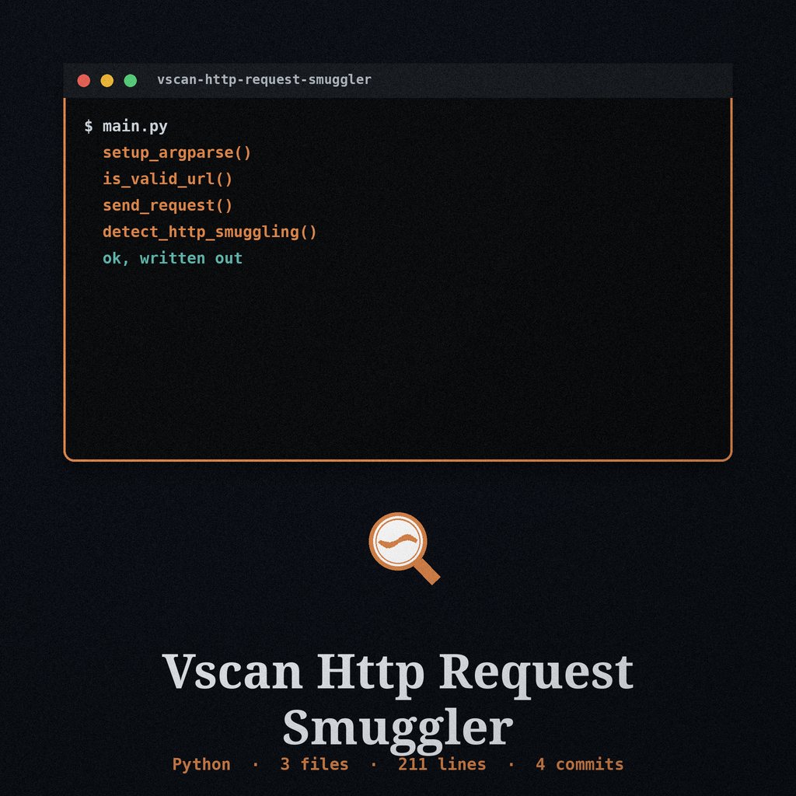
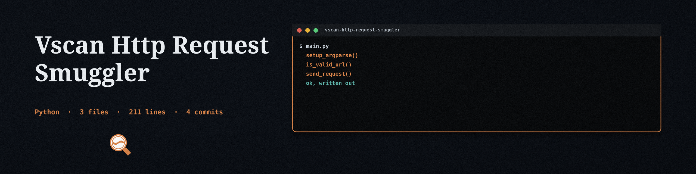

# vscan-http-request-smuggler
Detects HTTP Request Smuggling vulnerabilities by sending crafted requests with conflicting framing headers and analyzing how the server answers a follow-up probe on the same connection.

## Install
`git clone https://github.com/ShadowGuard-AI/vscan-http-request-smuggler`

Then install the single dependency: `pip install -r requirements.txt` (requests).

## Usage
`python3 main.py <url> [options]`

Example: `python3 main.py http://127.0.0.1:8080/ --timeout 5 --verbose`

## Parameters
- `--method`: HTTP method used for the crafted requests (default: GET).
- `--data`: Body sent with each crafted request instead of the default smuggling payload body. When a body is supplied, the embedded marker request is not sent, so the follow-up probe check cannot produce a positive for that run.
- `--headers`: Custom headers to include (JSON format). Custom Content-Length and Transfer-Encoding headers are ignored with a warning, because the test framing headers must reach the server exactly as written.
- `--timeout`: Request timeout in seconds (default: 10).
- `--verbose`: Enable verbose output. Verbose output shows status codes, header names, and sizes only; header values and response bodies are never logged.

## How detection works
Each of the three tests (CL.TE, TE.CL, TE.TE) sends one crafted request with raw socket framing so the conflicting Content-Length and Transfer-Encoding headers reach the server as written, then sends a normal probe request on the same connection. A test reports a vulnerability only when the probe response body contains the marker sentence `SMUGGLED_RESPONSE_FOR /__smuggled_<test>` for the marker request embedded in the crafted body, which is an observable desync effect against a server that renders that marker. This is a conservative signal: a desynced server that answers the smuggled request with an ordinary page or error is reported as no finding. Responses are read with size caps (64 KB of headers, 1 MB of body) and both Content-Length and chunked Transfer-Encoding framing are decoded. If no test request completes, the scan reports failure and exits non-zero instead of reporting a clean result.

## License
MIT (see LICENSE).
